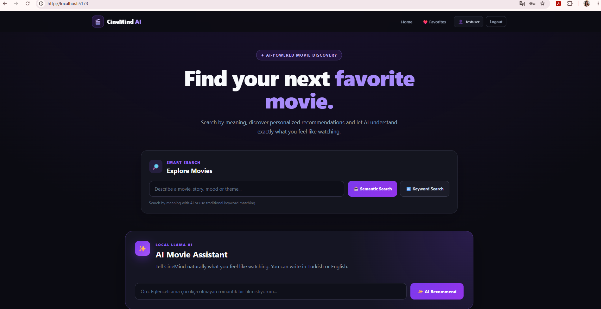
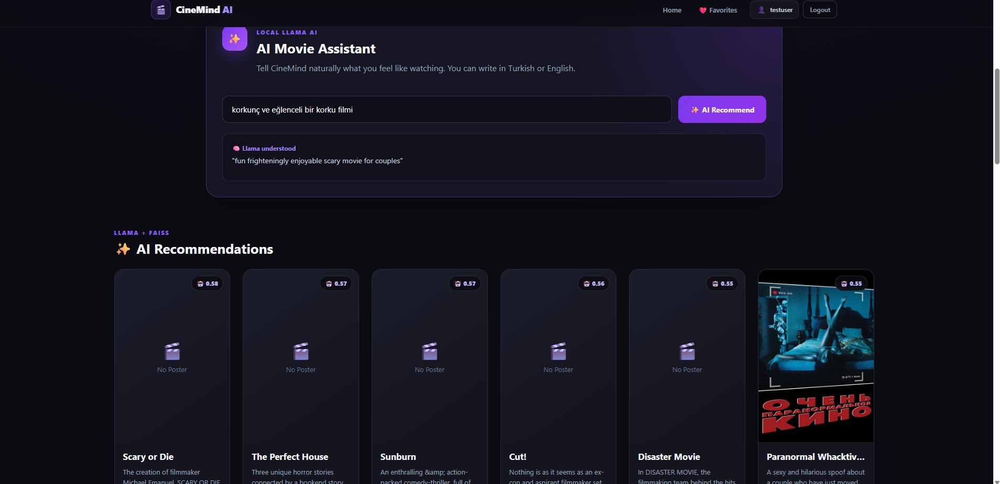
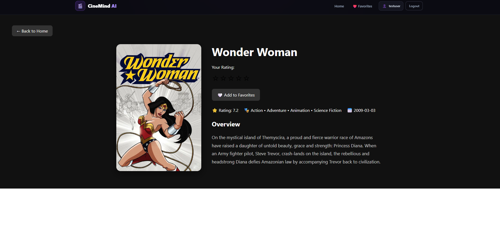
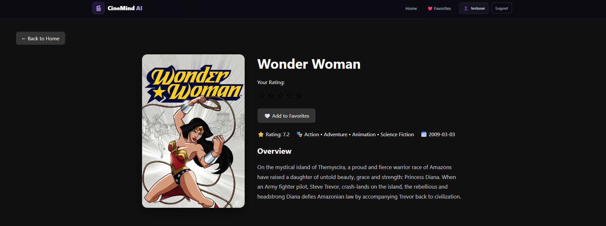
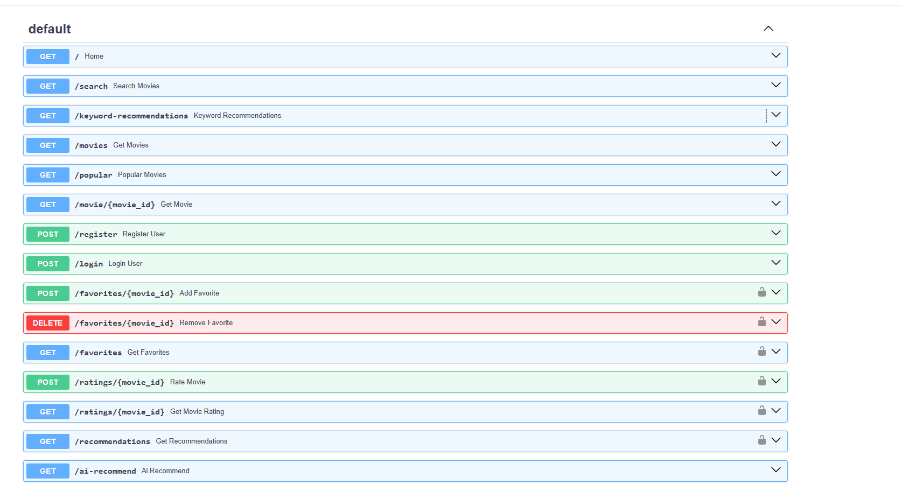

# 🎬 CineMind AI

[](https://github.com/Yesamer0/cinemind-ai/actions/workflows/ci.yml)

**AI-Powered Personalized Movie Recommendation System**

CineMind AI is a full-stack movie discovery and recommendation platform that combines traditional recommendation algorithms, NLP, semantic search, vector retrieval, personalized hybrid ranking, and a local Large Language Model (LLM).

Users can search for movies by meaning, rate and save movies, receive personalized recommendations, or simply describe what they want to watch in natural language.

---

## ✨ Features

### 🤖 AI Movie Assistant
Users can describe the type of movie they want to watch using natural language.

Example:

```text
Sevgilimle izleyebileceğim eğlenceli ama çocukça olmayan romantik bir film istiyorum.
```

CineMind processes the request through:

```text
Natural Language Request
        ↓
Local Llama 3.2 (Ollama)
        ↓
English Semantic Query
        ↓
Sentence Transformer
        ↓
Vector Embedding
        ↓
FAISS Vector Search
        ↓
Movie Recommendations
```

The LLM is used to understand and rewrite the request, while movie retrieval remains grounded in the CineMind movie dataset.

---

### 🔎 Semantic Movie Search

CineMind uses the `all-MiniLM-L6-v2` Sentence Transformer model to represent movie descriptions and user queries as semantic embeddings.

This allows users to search by meaning rather than only exact keywords.

Example:

```text
mysterious science fiction movie set in space
```

The query is converted into an embedding and compared against movie vectors using FAISS.

---

### 🔤 Keyword-Based Recommendation

A traditional NLP recommendation pipeline is also available using:

- Text cleaning
- Stopword removal
- Lemmatization
- TF-IDF vectorization
- Cosine similarity

This provides a useful comparison between classical NLP and modern semantic search.

---

### 🎯 Personalized Hybrid Recommendation

Logged-in users can rate movies from **1 to 5 stars**.

Movies rated 4 or 5 stars are used to generate personalized recommendations.

The hybrid recommendation engine combines:

```text
40%  TF-IDF Content Similarity
30%  Semantic Similarity
20%  TMDB Rating
10%  Popularity
```

Candidate movies are generated using both TF-IDF and FAISS semantic retrieval before being ranked by the hybrid scoring system.

---

### ⚡ FAISS Vector Search

CineMind uses FAISS for efficient nearest-neighbor search over movie embeddings.

The current semantic index contains approximately **44,500 movie vectors**, generated using Sentence Transformers.

FAISS `IndexFlatIP` is used with normalized embeddings for similarity retrieval.

---

### ❤️ Favorites

Authenticated users can:

- Add movies to favorites
- Remove movies from favorites
- View their personal favorites page

Favorites are stored per user in the database.

---

### ⭐ Movie Ratings

Users can rate movies from **1–5 stars**.

Ratings are stored in the database and are also used by the personalized recommendation engine.

---

### 🔐 Authentication

CineMind includes:

- User registration
- User login
- Password hashing with bcrypt
- JWT authentication with one-hour access tokens
- Protected API endpoints
- User-specific favorites
- User-specific ratings

---

### 🔥 Popular Movies

The Home page also displays popular movies using TMDB metadata such as popularity, vote count, and rating information.

---

## 🧠 AI Architecture

```text
                         ┌─────────────────┐
                         │  React Frontend │
                         └────────┬────────┘
                                  │
                                  │ Axios / HTTP
                                  ▼
                         ┌─────────────────┐
                         │     FastAPI     │
                         └────────┬────────┘
                                  │
              ┌───────────────────┼───────────────────┐
              │                   │                   │
              ▼                   ▼                   ▼
         TF-IDF NLP       Sentence Transformer    Llama 3.2
              │                   │                (Ollama)
              │                   ▼                   │
              │             Movie Embeddings          │
              │                   │                   │
              │                   ▼                   │
              │                 FAISS ◄───────────────┘
              │                   │
              └───────────┬───────┘
                          ▼
                 Hybrid Recommendation
                          │
                          ▼
                   Movie Results
```

---

## 🛠️ Tech Stack

### Backend

- Python
- FastAPI
- Uvicorn
- SQLAlchemy
- JWT Authentication
- bcrypt
- Pandas
- NumPy
- Scikit-learn

### AI / Machine Learning

- Sentence Transformers
- `all-MiniLM-L6-v2`
- FAISS
- TF-IDF
- Cosine Similarity
- NLP text preprocessing
- Ollama
- Llama 3.2

### Frontend

- React
- Vite
- React Router
- Axios
- JavaScript
- CSS

### Data

- TMDB Movie Metadata
- MovieLens

---

## 📁 Project Structure

```text
CineMind-AI/
│
├── backend/
│   ├── app/
│   │   ├── api.py
│   │   ├── main.py
│   │   ├── routers/
│   │   ├── content_based.py
│   │   ├── data_loader.py
│   │   ├── database.py
│   │   ├── llm_service.py
│   │   ├── models.py
│   │   ├── recommender.py
│   │   └── semantic_search.py
│   │
│   └── requirements.txt
│
├── dataset/
│   ├── movielens/
│   └── tmdb/
│
├── docs/
│   ├── architecture.md
│   ├── daily-log-01.md
│   └── project-plan.md
│
├── frontend/
│   └── src/
│       ├── components/
│       ├── pages/
│       ├── App.jsx
│       ├── App.css
│       └── index.css
│
├── models/
├── notebooks/
├── screenshots/
├── .gitignore
└── README.md
```

---

## 🔌 Main API Endpoints

| Method | Endpoint | Description |
|---|---|---|
| GET | `/` | API status |
| GET | `/search` | Semantic movie search |
| GET | `/keyword-recommendations` | TF-IDF keyword recommendations |
| GET | `/ai-recommend` | Natural-language AI recommendations |
| GET | `/movies` | Movie list |
| GET | `/popular` | Popular movies |
| GET | `/movie/{movie_id}` | Movie details |
| POST | `/register` | User registration |
| POST | `/login` | User login |
| GET | `/recommendations` | Personalized hybrid recommendations |
| POST | `/favorites/{movie_id}` | Add favorite |
| GET | `/favorites` | User favorites |
| DELETE | `/favorites/{movie_id}` | Remove favorite |
| POST | `/ratings/{movie_id}` | Rate movie |
| GET | `/ratings/{movie_id}` | Get user rating |

Interactive API documentation is available through FastAPI Swagger at:

```text
http://127.0.0.1:8000/docs
```

---

## 🚀 Running the Project

### 1. Clone the repository

```bash
git clone https://github.com/Yesamer0/cinemind-ai.git
cd cinemind-ai
```

### 2. Create a Python 3.12 virtual environment

```bash
python -m venv venv
```

Windows:

```powershell
.\venv\Scripts\Activate.ps1
```

### 3. Install backend dependencies

```bash
python -m pip install -r backend/requirements.txt
python -m nltk.downloader wordnet
```

### 4. Configure environment variables

Create:

```text
backend/.env
```

Add your JWT secret:

```env
SECRET_KEY=your-secret-key
```

Do not commit this file to GitHub.

### 5. Prepare the dataset and embeddings

Download [The Movies Dataset](https://www.kaggle.com/datasets/rounakbanik/the-movies-dataset) and extract `movies_metadata.csv` to `dataset/tmdb/movies_metadata.csv`. The API needs only this TMDB file. If you use the credits or keywords loaders, place `credits.csv` and `keywords.csv` in the same directory. The MovieLens CSVs are already in the repository.

The first semantic request builds `movie_embeddings.pkl` in the project root and downloads `all-MiniLM-L6-v2` if it is missing from the Hugging Face cache. The first request can take several minutes on CPU. To build the cache before starting the server, run this from the repository root:

```bash
python -c "from backend.app.semantic_search import load_semantic_index; load_semantic_index()"
```

Use only a locally generated pickle. If the catalog changes, stop the server and remove the old embedding cache before regenerating it. Keep the original metadata row order for an existing `cinemind.db`: stored ratings and favorites use catalog row IDs.

### 6. Install Ollama

CineMind uses a local Llama model through Ollama.

After installing Ollama, download the model:

```bash
ollama run llama3.2:1b
```

The local Ollama service should be available before using the AI Movie Assistant.

### 7. Start the backend

From the project root:

```bash
python -m uvicorn backend.app.main:app --reload
```

Backend:

```text
http://127.0.0.1:8000
```

Swagger:

```text
http://127.0.0.1:8000/docs
```

### 8. Start the frontend

Open another terminal:

```bash
cd frontend
npm ci
npm run dev
```

Frontend:

```text
http://localhost:5173
```

---

If the API runs at a different address, set `VITE_API_BASE_URL` in `frontend/.env` before starting Vite. `VITE_TMDB_IMAGE_BASE_URL` overrides the poster CDN. For a different frontend origin, set `CORS_ORIGINS` in `backend/.env` to a comma-separated list of allowed origins.

## Docker Compose

Prepare `dataset/tmdb/movies_metadata.csv` as described above. Create a project-root `.env` with a local `SECRET_KEY` for Compose. Run these commands from the repository root:

```bash
docker compose up -d --build
docker compose exec ollama ollama pull llama3.2:1b
docker compose exec backend python -c "from backend.app.semantic_search import load_semantic_index; load_semantic_index()"
```

Open the UI at http://localhost:8080 or Swagger at http://127.0.0.1:8000/docs. Docker stores SQLite, embeddings, and the downloaded models in named volumes. The first TF-IDF request also builds an in-memory index. Stop the services with `docker compose down`.

## Tests and evaluation

Run from the repository root:

```bash
python -m pip install -r backend/requirements-dev.txt
python -m pytest -q backend/tests
python -m backend.evaluate --k 5
```

The tests use a temporary SQLite database. [GitHub Actions CI](https://github.com/Yesamer0/cinemind-ai/actions/workflows/ci.yml) runs the backend tests, frontend lint, and frontend build on pull requests and pushes to `main`. CI runs without the TMDB dataset, embeddings, or Ollama.

The benchmark uses [32 English queries](dataset/eval/queries.json) and [12 paired Turkish queries](dataset/eval/queries-tr.json) with manually assigned TMDB IDs. The labels were set before inspecting the rankings. Each query contributes equally to the averages. Precision@5 divides unique labeled hits by five. Recall@10 divides hits by the number of labels. Binary NDCG@10 gives more credit to early hits, and MRR@10 averages the reciprocal rank of the first hit, using zero when the first ten contain no hit.

### English text queries (32)

Each method receives the same text. Query hybrid scores the union of the top 20 TF-IDF and top 20 MiniLM + FAISS candidates with the production weights (40% TF-IDF, 30% semantic, 20% rating, 10% popularity). The ablation keeps the same candidates and text weights and sets both metadata weights to zero.

BM25 uses the same cleaned overviews and vocabulary as TF-IDF with `k1=1.2` and `b=0.75`. RRF combines the top 20 BM25 and top 20 semantic results by rank with `k=60`. [BM25 reference](https://lucene.apache.org/core/10_5_2/core/org/apache/lucene/search/similarities/BM25Similarity.html) · [RRF paper](https://cormack.uwaterloo.ca/cormacksigir09-rrf.pdf)

| Method | Precision@5 | Recall@10 | NDCG@10 | MRR@10 |
| --- | ---: | ---: | ---: | ---: |
| TF-IDF | 0.062 | 0.164 | 0.109 | 0.131 |
| MiniLM + FAISS | 0.094 | 0.201 | 0.168 | 0.261 |
| Query hybrid | **0.156** | **0.315** | **0.303** | **0.480** |
| Hybrid without rating and popularity | 0.088 | 0.206 | 0.156 | 0.224 |
| BM25 | 0.088 | 0.219 | 0.170 | 0.236 |
| RRF (BM25 + semantic) | 0.088 | 0.253 | 0.186 | 0.256 |

Removing both metadata signals drops NDCG@10 from 0.303 to 0.156. The experiment measures their joint contribution. Many labels come from familiar franchises, so the result may reflect how this query set rewards well-known movies.

### Paired Turkish text queries (12)

The Turkish and English versions share the same labels. Queries go directly to the rankers over English overviews. This run skips the LLM translation used by the AI assistant.

| Method | Turkish P@5 | Turkish R@10 | Turkish NDCG@10 | Turkish MRR@10 | Paired English NDCG@10 |
| --- | ---: | ---: | ---: | ---: | ---: |
| TF-IDF | 0.000 | 0.000 | 0.000 | 0.000 | 0.201 |
| MiniLM + FAISS | 0.000 | 0.000 | 0.000 | 0.000 | 0.189 |
| Query hybrid | 0.000 | 0.000 | 0.000 | 0.000 | 0.327 |
| Hybrid without rating and popularity | 0.000 | 0.000 | 0.000 | 0.000 | 0.224 |
| BM25 | 0.000 | 0.000 | 0.000 | 0.000 | 0.232 |
| RRF (BM25 + semantic) | 0.000 | 0.000 | 0.000 | 0.000 | 0.202 |

Run just the Turkish benchmark with `python -m backend.evaluate --language tr`.

### Recommendations from one liked movie (32)

Each method receives the first labeled movie as the seed. The seed is excluded and the remaining labels are held out. The hybrid rows use the personalized ranker behind `/recommendations` with the metadata signals enabled or disabled. This single-like setup does not measure recommendations for users with longer histories.

| Method | Precision@5 | Recall@10 | NDCG@10 | MRR@10 |
| --- | ---: | ---: | ---: | ---: |
| Movie-to-movie TF-IDF | 0.219 | 0.620 | 0.530 | 0.575 |
| Movie-to-movie MiniLM + FAISS | 0.263 | **0.661** | 0.568 | 0.607 |
| Personalized hybrid | **0.275** | **0.661** | **0.638** | **0.734** |
| Hybrid without rating and popularity | 0.263 | **0.661** | 0.627 | 0.708 |

Metadata removal has a smaller effect here. NDCG@10 falls from 0.638 to 0.627, and Recall@10 remains 0.661.

### Why two queries originally scored zero

| Query | Best labeled film | TF-IDF rank | Semantic rank |
| --- | --- | ---: | ---: |
| Wizard school and magic lessons | Harry Potter and the Philosopher's Stone | 37 | 41 |
| A boxing underdog trains for a title fight | Rocky | 57 | 33 |

All four Harry Potter titles and all six boxing labels were present with the expected TMDB IDs. For the wizard query, semantic search ranked *Magic Camp* first and TF-IDF ranked *Magic Boy* first. Both overviews describe learning magic, while several Potter sequels center on specific events at Hogwarts. For the boxing query, *Irudhi Suttru* ranked first semantically and *The Opponent* first in TF-IDF. They are plausible matches outside the original labels. In both cases, every labeled movie fell outside the top-20 pools, so the query hybrid could not recover them.

```bash
python -m backend.evaluate --inspect "wizard school and magic lessons" --inspect "a boxing underdog trains for a title fight"
```

With Compose running, the evaluator is also available via `docker compose exec backend python -m backend.evaluate`.

## Demo video

[Watch the CineMind AI walkthrough](docs/cinemind-demo.mp4). This captioned demo uses project screenshots to show the home page, AI assistant, personalized recommendations, movie details, and API docs.

## 🎯 Recommendation Methods

CineMind provides multiple recommendation approaches:

| Method | Technique |
|---|---|
| Keyword Search | TF-IDF + Cosine Similarity |
| Semantic Search | Sentence Transformers + FAISS |
| Personalized Recommendations | Hybrid Ranking |
| Natural Language Recommendations | Llama + Sentence Transformers + FAISS |
| Popular Movies | TMDB popularity metadata |

This makes CineMind useful for comparing traditional recommendation techniques with modern semantic and LLM-assisted retrieval.

---

## 🔒 Security

Sensitive information is excluded from version control.

The following files are ignored:

```text
backend/.env
venv/
node_modules/
movie_embeddings.pkl
*.db
```

JWT secrets should only be stored in the local `.env` file. Protected routes reject expired tokens and require an expiration claim. Sign in again if your session expires or you still have a token issued before expiration was introduced.

The frontend currently stores the bearer token in `localStorage`. JavaScript executing on the frontend origin can read it, so an XSS flaw could expose the token until it expires. A cookie-based alternative would use `HttpOnly`, `Secure`, and an appropriate `SameSite` setting, with CSRF protection for state-changing requests. `HttpOnly` prevents JavaScript from reading the cookie, while injected scripts can still make authenticated requests from the page. See the [OWASP Session Management Cheat Sheet](https://cheatsheetseries.owasp.org/cheatsheets/Session_Management_Cheat_Sheet.html).

---

## 📸 Screenshots

### Home Page



### AI Movie Assistant



### Personalized Recommendations



### Movie Detail



### FastAPI Swagger



---

## 🔮 Future Improvements

Possible future improvements include:

- Approximate FAISS indexes for larger datasets
- Collaborative filtering
- More advanced hybrid ranking
- User recommendation history
- Improved multilingual query understanding
- Cloud deployment
- Larger local LLM models

---

## 👩‍💻 Project Purpose

CineMind AI was developed as a practical full-stack AI project to explore the complete recommendation-system pipeline:

```text
Data
→ NLP
→ Embeddings
→ Vector Search
→ Recommendation
→ REST API
→ Authentication
→ Frontend
→ Local LLM Integration
```

The project demonstrates how classical machine-learning techniques and modern semantic AI methods can be combined in a single end-to-end application.